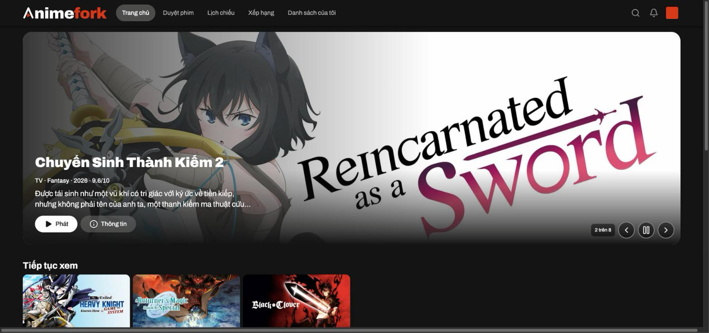
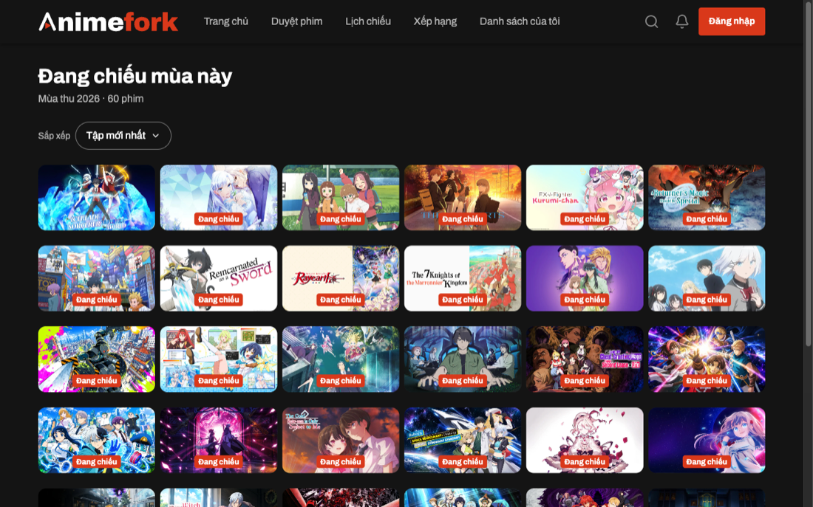
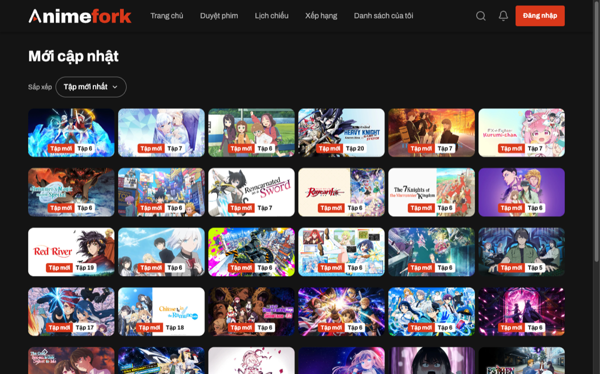
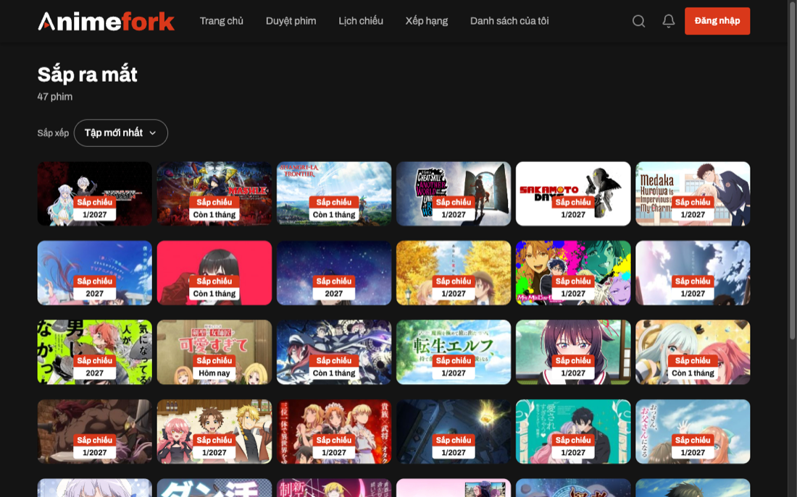

# Animefork

Animefork is a fast, Netflix-style way to browse and watch anime from AnimeVsub: shelves of new episodes, a Top 10, what is airing this season and what is coming next.

Live site: **https://animefork.com**

> [!IMPORTANT]
> The website reads anime pages through a small browser add-on, **Animefork Helper**. Without it the site shows an error screen. Installing it takes about two minutes and is described below.

## What it looks like

**Home.** A hero carousel, then shelves for new episodes, today's Top 10, airing this season and upcoming titles.



**Airing this season.** Every show of the current season, sortable by latest episode or rating.



**New episodes.** Everything that just got a new episode.



**Upcoming.** Shows that are coming soon, with release dates where known.



## Install the extension (Chrome, Edge, Brave, Opera)

Chrome-based browsers let you add an extension by hand. This is called "developer mode". It is safe: you are only telling the browser to load a folder you downloaded yourself. You do not need to know how to code.

### 1. Download it

1. Open the [Releases page](https://github.com/tult98/animefork/releases).
2. Under the newest release, click the file ending in **`-chrome.zip`** (for example `animefork-helper-1.0.50-chrome.zip`) to download it.

### 2. Unzip it

- **Mac:** double-click the zip file.
- **Windows:** right-click the zip file, then **Extract All…**

You get a folder. **Move it somewhere permanent** such as your Documents folder. The browser reads the extension from that folder every time it starts, so if you delete or move the folder, the extension stops working.

Inside the folder you should see a file called `manifest.json`. If you only see another folder, open it and use that one.

### 3. Turn on developer mode and load it

1. In the address bar, type `chrome://extensions` and press Enter. (Edge: `edge://extensions`. Brave: `brave://extensions`. Opera: `opera://extensions`.)
2. Switch on **Developer mode**. It is a toggle in the top right (Edge: bottom left).
3. Click **Load unpacked**.
4. Choose the folder from step 2, the one that contains `manifest.json`, and confirm.

**Animefork Helper** now appears in your list of extensions.

### 4. Use the site

Open **https://animefork.com**. The home page should fill with shelves. If you opened the site before installing the extension, refresh the page.

Tip: click the puzzle-piece icon in the toolbar and pin Animefork Helper if you want to see that it is on.

### Troubleshooting

| What you see                                                  | What to do                                                                                                  |
| ------------------------------------------------------------- | ----------------------------------------------------------------------------------------------------------- |
| The site says the extension is missing                        | Check it is switched on at `chrome://extensions`, then refresh the page.                                    |
| "Manifest file is missing or unreadable" when loading         | You picked the wrong folder. Pick the one that directly contains `manifest.json`.                           |
| The extension disappeared after you restarted or tidied files | The folder was moved or deleted. Put it back, or unzip again and use **Load unpacked** once more.           |
| A banner says "Disable developer mode extensions"             | Chrome shows this on every start for hand-loaded extensions. Dismiss it, do not click **Disable**.          |
| Videos do not play                                            | Make sure you are on the `https://` address. Some networks block the video host, so try another connection. |

### Firefox

Download the file ending in **`-firefox.zip`** from the Releases page. Open `about:debugging#/runtime/this-firefox`, click **Load Temporary Add-on…** and pick the zip. Firefox forgets temporary add-ons when it closes, so you have to load it again each time.

### Updating

When a new release comes out, download and unzip it, then replace the contents of your old folder with the new files. Open `chrome://extensions` and click the circular **reload** arrow on Animefork Helper.

## For developers

This is an [Nx](https://nx.dev) monorepo managed with pnpm.

| Folder             | What it is                                                                |
| ------------------ | ------------------------------------------------------------------------- |
| `apps/web`         | The website (React 19, Vite, TanStack Router and Query, Tailwind 4)       |
| `apps/extension`   | Animefork Helper, built with [WXT](https://wxt.dev)                       |
| `apps/api`         | Service for artwork lookups and accounts                                  |
| `apps/desktop-web` | The older Vue version of the site, kept until the rebuild replaces it     |
| `deploy`           | Docker Compose setup for the server, see [docs/deploy.md](docs/deploy.md) |

Setup needs the Node version in `.nvmrc` and pnpm (the version is pinned in `package.json`).

```sh
pnpm install
pnpm nx dev web                              # site on http://localhost:5180
pnpm nx build extension-animevsub-helper     # builds apps/extension/dist/chrome-mv3
```

To run the local site you also need the extension: load `apps/extension/dist/chrome-mv3` with **Load unpacked** as described above. Run checks with `pnpm nx run-many -t lint typecheck test build`. More detail is in [apps/web/README.md](apps/web/README.md).

### Releasing the extension

Releases are built by [`.github/workflows/release-extension.yml`](.github/workflows/release-extension.yml) and published to [GitHub Releases](https://github.com/tult98/animefork/releases).

1. Bump `version` in `apps/extension/package.json` and merge it to `main`.
2. Tag that commit and push the tag:

   ```sh
   git tag v1.0.51
   git push origin v1.0.51
   ```

The workflow checks that the tag matches the version, runs lint and tests, builds the Chrome and Firefox zips, and creates the release with generated notes. The two files attached are `animefork-helper-<version>-chrome.zip` and `animefork-helper-<version>-firefox.zip`.

## License

MIT, see [apps/extension/LICENSE](apps/extension/LICENSE).
